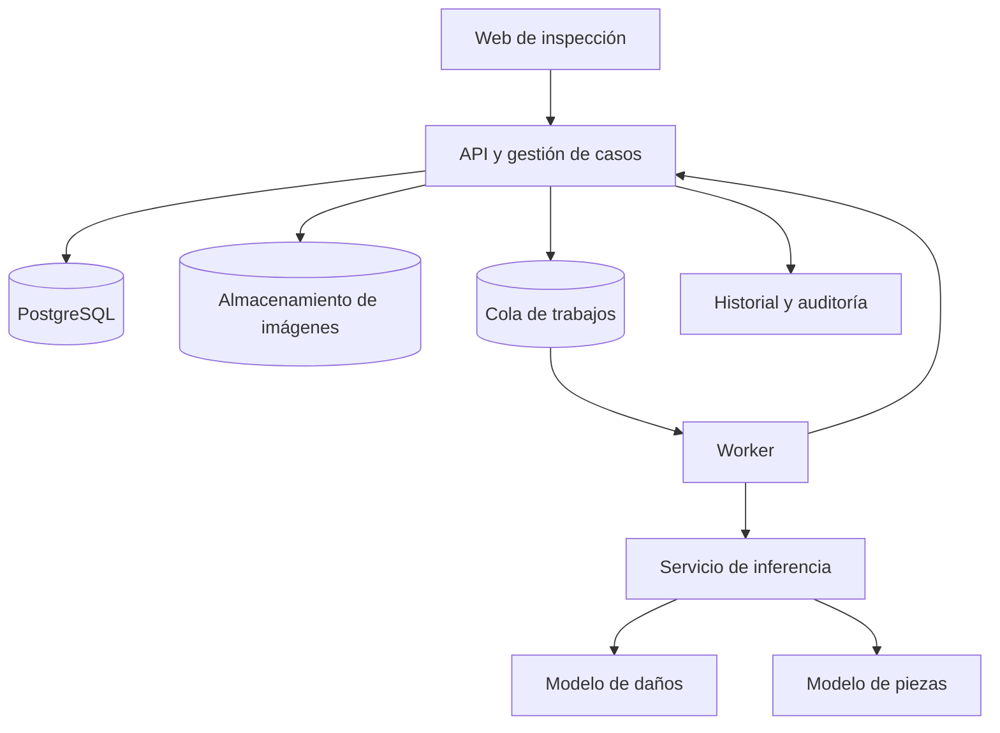

  

<h1 align="center">AutoCheck</h1>

  <strong>Inspección vehicular asistida por IA, con evidencia visual y revisión humana.</strong>

  AutoCheck transforma fotografías de un vehículo en un prediagnóstico estructurado: 
  detecta daños, identifica las piezas afectadas, propone un rango explicable de reparación 
  y conserva la trazabilidad de cada decisión.

  
  
  

---

## De una foto a una evaluación asistida

## ¿Qué problema resuelve?

Una inspección vehicular no termina al encontrar una abolladura. También hay que determinar **dónde está**, **qué pieza afecta**, **qué evidencia respalda el diagnóstico** y **cómo se llegó a una estimación**.

AutoCheck reúne ese proceso en un único flujo reproducible:

| Capacidad | Resultado |
| --- | --- |
| Análisis visual | Localiza daños y piezas mediante máscaras y niveles de confianza. |
| Evidencia | Superpone los resultados sobre las imágenes originales. |
| Estimación explicable | Desglosa un rango orientativo según pieza, daño, severidad y reglas versionadas. |
| Revisión humana | Permite confirmar, rechazar o corregir las predicciones. |
| Trazabilidad | Vincula imagen, modelo, parámetros, resultado y revisión. |

## Diseñado para asistir, no para decidir solo

> [!IMPORTANT]
> AutoCheck es un sistema de apoyo a la inspección. Las predicciones y estimaciones relevantes requieren revisión humana y no aprueban reclamos ni presupuestos automáticamente.

La explicabilidad y la intervención del perito son parte del producto, no una corrección posterior. Cuando la evidencia es insuficiente, el sistema deriva el caso a revisión en lugar de presentar una certeza que no posee.

## Arquitectura del MVP

El entorno está pensado para ejecutarse localmente mediante contenedores, separando la aplicación operativa del entrenamiento de los modelos.

## Estado del proyecto

AutoCheck se encuentra en fase de **MVP académico**. El trabajo actual está concentrado en:

- integración de los modelos de daños y piezas;
- revisión visual y mejora de la calidad de datos;
- estimaciones de costo explicables y versionadas;
- experiencia de revisión para el perito;
- pruebas end-to-end y reproducibilidad del entorno.

El código permanece privado durante esta etapa de desarrollo. Esta portada comunica el alcance, las decisiones de diseño y el progreso del proyecto sin exponer datos ni activos restringidos.

## Principios del proyecto

`Evidencia antes que certeza` · `Revisión humana` · `Trazabilidad completa` · `Datos con procedencia` · `Resultados reproducibles`

---

  <strong>Proyecto académico de Machine Learning e Ingeniería de Software.</strong> 
  Construido para explorar una inspección vehicular más clara, consistente y auditable.

